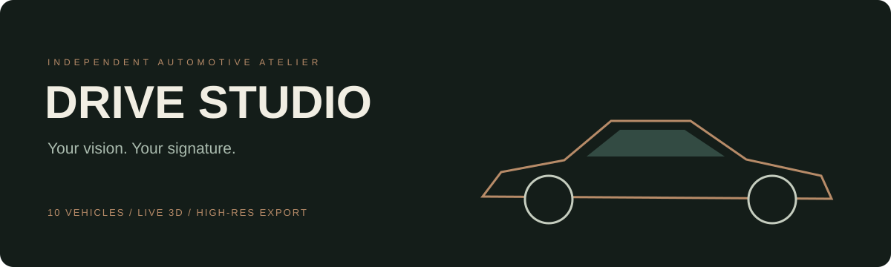

# DRIVE STUDIO



[](https://github.com/berkayozdmr21/drive-studio/actions/workflows/ci.yml)


An interactive automotive design studio built with React, Three.js and FastAPI. Choose between ten 3D vehicles, shape their appearance, and save a collection of personal design studies.

Developed by **Berkay Özdemir** · [GitHub](https://github.com/berkayozdmr21)

## The experience

- Ten vehicles: the licensed Ferrari 458 Italia plus nine original procedural concepts — Apex GT, Volt S, Terra X, Metro R, Nomad Utility, Aero One, Coast Spider, Trail Rally and Atlas Touring. These concepts are not manufacturer replicas.
- Model-specific base prices, persistent selection and shared designs. Legacy configurations without a vehicle ID open as the Ferrari.
- Real-time metallic and satin paint, five body colors, three wheel styles, two interiors and an optional rear wing.
- A procedural studio environment, day/night lighting, headlight controls, orbit interaction and five camera perspectives.
- GSAP entrance and scroll animations, responsive controls and reduced-motion support.
- High-resolution PNG renders at 1920, 2560 or 3840 pixels wide, with optional transparent background and model attribution, configuration JSON export and a persistent local draft.
- SQLite design collections, public design links and server-calculated demonstration prices.
- A model-specific 2D silhouette preview when WebGL 2 is unavailable or the model fails to load.

This is an independent portfolio project. It is not affiliated with Ferrari. Prices, customization packages and availability are fictional and do not constitute a sales offer.

## Start on Windows

1. Install Python 3.10 or newer.
2. Clone this repository or download it with **Code → Download ZIP**, then extract it.
3. Double-click **BASLAT.cmd**. The first launch installs Python dependencies and needs internet access.
4. Keep the terminal open. The browser opens after the health check succeeds.

The launcher prefers `http://127.0.0.1:8960` and selects another available port if necessary. The repository includes a frontend build, so Node.js and API keys are not required to run it. Python dependencies are installed in the project's `.venv`.

## Development

Use Node.js 22 and Python 3.10+.

```sh
git clone https://github.com/berkayozdmr21/drive-studio.git
cd drive-studio
```

```powershell
python -m venv .venv
.venv\Scripts\python -m pip install -r requirements.txt
cd frontend
npm ci
npm run build
cd ..
.venv\Scripts\python run.py
```

For frontend hot reload, start the API with `python -m uvicorn backend.main:app --port 8960`, then run `npm run dev` in `frontend`. Vite proxies `/api` to that port. Production serves the build and API from the same origin.

## Architecture

| Layer | Implementation |
| --- | --- |
| Interface | React 19, CSS, Lucide icons, GSAP |
| Rendering | Three.js, React Three Fiber, Drei, local Draco decoder |
| API | FastAPI, Pydantic validation |
| Persistence | SQLite, anonymous owner cookie |
| Delivery | Vite build, Windows launcher, Docker Compose, GitHub Actions |

`frontend/src/CarScene.jsx` owns the 3D scene; `config.js` defines validated import options and UI estimates. `backend/main.py` validates submitted configurations, calculates authoritative demo totals and persists designs. The UI loads the catalog from the API with a bundled fallback.

## API

Interactive documentation is available at `/docs` while the server is running.

| Method | Route | Purpose |
| --- | --- | --- |
| GET | `/api/health` | Health check |
| GET | `/api/catalog` | Configuration options |
| GET | `/api/session` | Start anonymous collection session |
| POST | `/api/quote` | Validate and price a configuration |
| GET / POST | `/api/designs` | List owned designs / save a design |
| GET | `/api/designs/{id}` | Read a shared design |
| DELETE | `/api/designs/{id}` | Delete an owned design |

Writes require `X-Studio-Client: drive-studio`. Cross-origin writes are blocked. The HttpOnly, SameSite cookie is an anonymous ownership token, not an account system. Saved designs are intentionally readable by anyone possessing their public link. Keep sensitive information out of design names. Clearing cookies loses collection ownership; deleting a design also invalidates its link. Each session can save up to 100 designs.

Localhost links work on the computer hosting the app. To share remotely, deploy the complete backend and frontend behind HTTPS with a persistent data volume. Public hosting also needs operational controls such as rate limiting, storage quotas and backups; those are not supplied by this local demo. Set `DRIVE_DATA_DIR` to change the SQLite storage directory.

## Docker

```sh
docker compose up --build
```

Open `http://127.0.0.1:8960`. SQLite persists in the `studio-data` volume. The container runs as an unprivileged user. Docker execution has not been verified in the delivery environment.

## Verification

```sh
python -m unittest discover -s tests -v
cd frontend
npm test -- --run
npm run build
```

**40 automated tests: 18 backend integration tests and 22 frontend tests.**

The automated suite covers server pricing and input rejection, ownership isolation, shared reads, deletion, CSRF checks, collection limits, static GLB/WASM delivery and frontend configuration/API helpers. It does not test GPU rendering or complete browser interactions. See [VERIFICATION.md](VERIFICATION.md) for delivery results and limits.

## Assets

The Ferrari 458 Italia model is by **vicent091036**, licensed **CC BY 4.0**. This project modifies paint, materials, wheel geometry, aero geometry and lighting. See [ASSETS.md](ASSETS.md) for the original source and decoder notices. Asset attribution is also available inside the interface and included in PNG exports.

Model and decoder files are bundled locally. Optional Google Fonts may require internet; system fonts provide a fallback. No paid service or API key is needed.

## Render exports

Use the download icon in the 3D studio to open the render menu. Choose a resolution and optionally enable transparent background. The current camera framing is preserved; the output height follows the viewport aspect ratio plus a 100-pixel attribution strip. Transparent exports hide the ground and contact shadow while retaining vehicle lighting. The renderer size, pixel ratio and scene visibility are restored after export, including on errors. Hardware texture limits are checked before allocating the export.

PNG is a static raster image of the 3D scene, not an interactive 3D model. These are real-time WebGL renders, not offline path-traced images. JSON exports preserve the selected vehicle and options.

## Vehicle design details

The nine concepts now have individually authored longitudinal body sections and roof profiles. Apex has a long hood and fastback roof; Volt has a separate sedan trunk and full-width front light; Terra has a box roof, off-road tires and rear spare; Metro has a short hatchback body; Nomad has an open pickup bed and roll bar; Aero has a low narrow canopy and wide splitter; Coast has an open cockpit and roll hoops; Trail has auxiliary rally lights, mud flaps and spoiler; Atlas has an extended wagon roof and rails. Model-specific silhouettes also appear in the 2D fallback.
